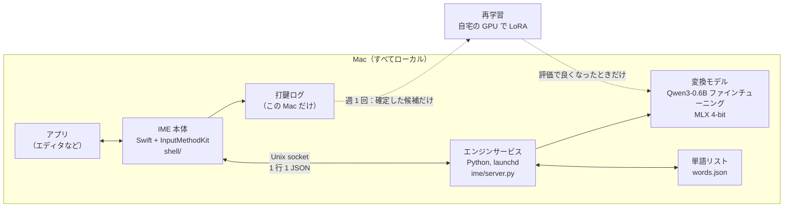

[日本語](README.md) | [中文](README.zh.md)

# LLM IME

中国語ピンインを**略して打てる** macOS の IME です。各音節の頭文字だけを打てば（`wjdzgxfh` → 我觉得这个想法很好）、ファインチューニングした小さな言語モデルが、カーソルの左にある文脈から文全体を当てます。モデルは Mac の中で動き（MLX、4-bit）、打った内容は外に出ません。


エディタで頭文字だけを打ち、スペースで確定しています（[mp4](assets/demo/llm-ime-reel.mp4)）。

## できること

- **頭文字・全拼・混在のどれでも打てる**：`nh` → 你好、`zgwtwmmtztl` → 这个问题我们明天再讨论。打ち方の切り替えはいりません。
- **文脈を読む**：前の文に合わせて同じキー列から違う文を出します。文脈がない場合の弱さは、チャット文体のデータでファインチューニングして補いました。
- **打ち間違いに強い**：隣り合う 2 キーの入れ替え（`zhognguo` → 中国）、キーが 1 つ多い・足りない・隣のキーを押した（`kanyuix` → 看一下）でも読めます。
- **使う言葉を覚える**：選んだ候補は Mac 内の単語リストに入り、次から前に出ます。週に一度、本人の確定履歴でモデルを LoRA で再学習し、良くなったときだけ入れ替えます。
- **待たせない**：キーを押すたびに、まず短い探索の答え（M3 MacBook Air で p50 約 50 ms）、続いて文全体の探索の答え（4〜8 キーで p50 約 80 ms）を返します。

## アーキテクチャ



- **IME 本体（`shell/`）**：InputMethodKit で書いた Swift のアプリ。候補ウィンドウ、ページ送り、確定、打鍵ログを受け持ちます。Xcode なしで、Command Line Tools の `swiftc` だけでビルドします（`shell/build.sh`）。
- **エンジンサービス（`ime/server.py`）**：キーごとの要求を受け、古い要求は捨てて最新のものだけに答えます。答えは 2 段階で、`quick`（短い探索）をすぐ返し、続けて `full`（文全体の beam search）を返します。
- **変換（`ime/llm.py`）**：モデルの語彙のうち漢字だけでできたトークンを、各字の読みで trie に入れておきます。beam search はこの trie で、打ったキーに合うトークンだけを伸ばします。全ビームを 1 バッチで計算し、文脈の KV cache は使い回します。

## モデルと学習

- **ベース**：Qwen3-0.6B-Base。ゼロショットでもピンイン制約つきの beam search はできますが、頭文字入力の P@1 は 11% でした。
- **学習データ**（`scripts/gen_train.py`）：LCCC（日常会話）と中国語 Wikipedia をほぼ 1:1、それに本人の WeChat で自分が送ったメッセージを約 5%。文のどこかで切り、その前を「文脈」、後ろの 2〜16 字を「正解」にします。キー列は全拼・頭文字・混在を同じ割合で、`pypinyin` で作りました。
- **プロンプト**：`文脈 + 打ったキー → 正解`。キーをプロンプトに入れることで、モデルは「このキーで書けそうな文」ではなく「このキーで書いた文」を学びます。
- **学習**：研究室の GPU（RTX 4090 など）でフルファインチューニング（`scripts/train.py`）。文脈のトークンにも重み 0.3 で LM loss をかけ、言語モデルとしての力を落とさないようにしました。
- **推論**：ファインチューニングしたモデルの点数に、ベースモデルが文脈だけから付けた点数を足します（`mix`）。片方だけより良い結果になりました。
- **週 1 回の再学習**（`scripts/retrain.py`）：本人の確定履歴から作ったサンプルで、自宅の RTX 4070 で LoRA（rank 16、2.2 GB）を学習し、評価してベースより良いときだけ入れ替えます。

## 評価

評価セットは 892 文（本人が書いた文 592 + 公開データ 300）で、同じ文を全拼・頭文字・混在の 3 通りで打ちます。指標は P@1（1 番目の候補が正解の割合、%）です。

| 入力 | n-gram + Viterbi（自作のベースライン） | Qwen3-0.6B ゼロショット | ファインチューニング後（v02） |
|---|---|---|---|
| 全拼 | 44.6 | 57.3 | **79.1** |
| 頭文字 | 3.1 | 11.1 | **18.4** |
| 混在 | 13.9 | 24.9 | **38.1** |

- 文脈が一番効きます。ゼロショットでも、16 字以上の文脈があると頭文字の P@1 は 2.7% から 23.1% に上がりました。n-gram は文脈を使えません。
- 頭文字だけの長い文は情報が少なすぎて、どの方法でも低くなります。実際には区切りながら確定していくので、エンジンも「キー列の先頭だけを読む候補」を出して部分確定できるようにしました。
- 打ち間違いの評価：キーを 1 つ多く打った混在入力の P@1 は 0.5% → 20.7%、隣のキーを押した場合は 0% → 8.6%。正しく打った入力の P@1 は変わっていません（同じ 200 文で 83.0 / 11.0 / 35.5 → 83.0 / 11.0 / 36.5）。

## 苦労した点

- **頭文字の P@1 は 11% から始まった。** ゼロショットのモデルは Wikipedia 調の文に寄っていて、チャットの短い文が苦手でした。プロンプトの言い回しを変えてもほぼ変わらず、キー列をプロンプトに入れたチャット文体のデータでファインチューニングしたことで、全拼 57 → 79、頭文字 11 → 18 まで上がりました。
- **1 つのモデルにまとめる試みは 2 回失敗した。** 推論を速くするため、2 モデルの点数を 1 モデルに蒸留する案（r4）と、各字を自分のキーの直後に並べる形式（r4b）を試しましたが、どちらも v02 に届きませんでした。r4b はキーの部分に loss をかけていなかったため、音節の切り方を間違えても罰がなく、8 時間学習してから気づきました。それ以来、新しい形式は数百ステップ学習して 20 文だけ評価してから本番の学習に入っています。
- **ベースモデルは自分のトークン化で採点させる。** 1 字 1 トークンで与えると、普段は長いトークンの中で書く字（还有 の 还 など）を低く見積もってしまいます。
- **打ち間違いを直した読みは、直したキーで探索し直す。** ファインチューニングしたモデルはプロンプトのキー列を見て採点するので、直した読みを打ったままのキー列で採点すると必ず負けます。打ったままでは読めないキーにだけ直した読みを別の行で足すことで、頭文字の略記を押しのけないようにしました。
- **遅さの原因は測ってから決める。** 打鍵ログでは容錯（打ち間違いへの対応）を入れたあと 13〜14% 遅くなったように見えましたが、原因は容錯ではなく、前のキーの文全体の探索を待っていた時間でした。同じプロセスでキーごとに新旧を交互に計測するスクリプト（`scripts/typo_bench.py`）で比べると、増えたのは p50 で 1% 未満でした。
- **自宅の 4070 で学習する。** ほかの用途で 12 GB のうち約 7.5 GB が埋まっているカードで、LoRA + gradient checkpointing + 4k トークンのバッチにして 2.2 GB に収めました。

## プライバシー

- 打った内容はその Mac から出ません。打鍵ログと単語リストはその Mac の中だけにあり、メニューの「删除全部记录」でログ、単語リスト、個人モデルをまとめて消せます。パスワードマネージャーでの入力は記録しません。
- 週 1 回の再学習のサンプルは本人の機器の間だけを移動し、学習が終われば消します。
- **モデルの重みは公開していません。** 本人のメッセージで学習したモデルは、学習文をそのまま出力してしまうおそれがあるためです。評価セットにも本人の文が入っているので、公開していません。このリポジトリにあるのはコードとドキュメントだけです。

## 動かし方

重みは含まれていないので、公開データで学習し直すか、ベースモデルのままゼロショットで試します。

```sh
python3 -m venv .venv && .venv/bin/pip install mlx mlx-lm numpy pypinyin jieba
# ゼロショット：Qwen3-0.6B-Base を MLX 4-bit に変換して試す
.venv/bin/mlx_lm.convert --hf-path Qwen/Qwen3-0.6B-Base -q --mlx-path models/qwen3-0.6b-base-4bit
make repl ARGS="--engines llm"
# 学習：models/Qwen3-0.6B-Base に HF 形式のモデル、data/corpus/ に LCCC と Wikipedia を置き（ime/corpus.py）、
# 学習データを作って学習する
# （--private を付けなければ公開データだけになる）。学習は CUDA の GPU で、別の venv（PyTorch + transformers）
python scripts/gen_train.py --out data/train
python scripts/train.py --out runs/r1
# IME 本体（macOS 13 以降、Apple Silicon）
shell/build.sh
```

## リポジトリ構成

| パス | 中身 |
|---|---|
| `ime/` | エンジン：ピンイン、n-gram ベースライン、LLM 変換、タイピングセッション、サービス、単語リスト |
| `shell/` | IME 本体（Swift / InputMethodKit）と候補ウィンドウのモック、テスト |
| `scripts/` | 学習データ生成、学習、評価、ベンチマーク、デプロイ、週 1 回の再学習 |
| `CLAUDE.md` | 開発中に見つけた落とし穴のメモ（英語） |

コメントや commit メッセージにある `5B.8`、`D-019` などは、開発で使っている計画表の項目番号です。

## 使っているデータとライセンス

- [Qwen3-0.6B-Base](https://huggingface.co/Qwen/Qwen3-0.6B-Base)（Apache-2.0）
- [LCCC](https://github.com/thu-coai/CDial-GPT)、中国語 Wikipedia（学習と字の頻度 `ime/char_freq.tsv`）
- [OpenCC](https://github.com/BYVoid/OpenCC) の字表（Apache-2.0、`ime/trad_chars.txt`）
- [SCOWL](http://wordlist.aspell.net)（`ime/en_words.txt`、ファイル内に著作権表示あり）
