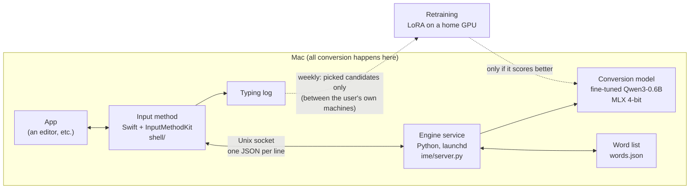

[English](README.md) | [日本語](README.ja.md) | [中文](README.zh.md)

# LLM IME

By iren ([iren.page](https://iren.page): more of my work)

A macOS input method for Chinese that lets you **type whole sentences in abbreviated pinyin**. Type only the first letter of each syllable (`wjdzgxfh` → 我觉得这个想法很好) and a small fine-tuned language model works out the whole sentence from the text left of the cursor. The model runs on the Mac itself (MLX, 4-bit); nothing you type is sent to the cloud for conversion.


Typing only initials in an editor; space enters the sentence ([mp4](assets/demo/llm-ime-reel.mp4)).

## What it does

- **Initials, full pinyin or a mix of both**: `nh` → 你好, `zgwtwmmtztl` → 这个问题我们明天再讨论. No mode to switch.
- **Reads the context**: the same keys give different sentences after different text. Fine-tuning on chat-style data made up for the base model's weakness when there is no context.
- **Forgives typos**: two adjacent keys swapped (`zhognguo` → 中国), a key too many, a key missing, or the key next to the right one (`kanyuix` → 看一下) still read right.
- **Learns your words**: picked candidates go into a word list on the Mac and come first next time. Once a week the model is retrained with a LoRA on the sentences you typed and picked that week, and swapped in only if it scores better.
- **Doesn't keep you waiting**: every key gets one quick answer (p50 46 ms for 1–3 keys, 69 ms for 4–8 keys, 68 ms for 9 or more, from real typing on an M3 MacBook Air); after a short pause the engine adds further candidates as later pages.

## Architecture



- **Input method (`shell/`)**: a Swift app on InputMethodKit. It handles the candidate window, paging, entering the picked text and the typing log. It builds with the Command Line Tools' `swiftc` alone, no Xcode (`shell/build.sh`).
- **Engine service (`ime/server.py`)**: takes a request per key, drops stale ones and answers only the newest. Each answer comes in two stages: `quick` (a short search) right away, then `full` (a beam search over the whole sentence).
- **Conversion (`ime/llm.py`)**: every token in the model's vocabulary made only of Han characters is indexed in a trie by its characters' readings. The beam search uses this trie to extend only the tokens that fit the typed keys. All beams run as one batch, and the context's KV cache is reused.

## Model and training

- **Base**: Qwen3-0.6B-Base. Zero-shot it can already do a pinyin-constrained beam search, but P@1 on initials was 11%.
- **Training data** (`scripts/gen_train.py`): LCCC (everyday conversation) and Chinese Wikipedia at about 1:1, plus about 5% messages the user sent on WeChat. Each line is cut at a random point: the text before is the context, the next 2–16 characters the target. Keys are made with `pypinyin`, full pinyin, initials and mixed in equal shares.
- **Prompt**: `context + typed keys → target`. With the keys in the prompt, the model learns "the sentence written with these keys", not just "a likely continuation".
- **Training**: full fine-tuning on lab GPUs (RTX 4090 and others, `scripts/train.py`). The context tokens also get an LM loss at weight 0.3, so the model keeps its language ability.
- **Inference**: the fine-tuned model's score plus the base model's score from the context alone (`mix`), which does better than either on its own.
- **Weekly retraining** (`scripts/retrain.py`): a LoRA (rank 16, 2.2 GB) trained on a home RTX 4070 with samples from the candidates the user picked that week, evaluated, and swapped in only if it beats the base.

## Evaluation

The eval set is 892 sentences (592 written by the user + 300 from public data), each typed three ways: full pinyin, initials and mixed. The metric is P@1 (how often the first candidate is right, %).

| Input | n-gram + Viterbi (own baseline) | Qwen3-0.6B zero-shot | Fine-tuned alone | Fine-tuned + base (`mix`, v02) |
|---|---|---|---|---|
| Full pinyin | 44.6 | 57.3 | 57.2 | **79.1** |
| Initials | 3.1 | 11.1 | 10.8 | **18.4** |
| Mixed | 13.9 | 24.9 | 20.7 | **38.1** |

The table is the whole-sentence search (all keys, top 5 candidates), not the quick answer typing shows first.

- Context matters most. Even zero-shot, 16+ characters of context took P@1 on initials from 2.7% to 23.1%. The n-gram model cannot use context.
- Long sentences in initials alone carry too little information, and every method scores low on them. In real typing a sentence goes in piece by piece, so the engine also offers candidates for the start of the keys, which can be picked on their own.
- Typos: on mixed input, P@1 with one extra key went 0.5% → 20.7%, with the key next to the right one 0% → 8.6%. P@1 on correctly typed input did not change (the same 200 sentences: 83.0 / 11.0 / 35.5 → 83.0 / 11.0 / 36.5).

## What was hard

- **P@1 on initials started at 11%.** The zero-shot model leaned towards Wikipedia-style text and struggled with short chat sentences; rewording the prompt hardly helped. Fine-tuning on chat-style data with the keys in the prompt did not lift P@1 by itself (full pinyin 57.3 zero-shot, 57.2 fine-tuned; mixed even fell from 24.9 to 20.7). Scoring each sentence with the fine-tuned and the base model together (`mix`) brought full pinyin from 57 to 79 and initials from 11 to 18.
- **Merging into one model failed twice.** To make inference faster I tried distilling the two models' combined score into one model (r4), and a format with each character right after its own keys (r4b). Neither caught up with v02. r4b put no loss on the keys, so splitting syllables wrong cost nothing, and I only found out after 8 hours of training. Since then every new format gets a few hundred steps and a 20-sentence eval before a full run.
- **The base model must score with its own tokenization.** Fed one character per token, it underrates characters it normally writes inside a longer token (还 in 还有).
- **A typo-corrected reading needs a search with the corrected keys.** The fine-tuned model scores against the keys in its prompt, so a corrected reading scored under the keys as typed always loses. Corrected readings are added, in beam rows of their own, only for keys that cannot be read as typed, so they don't push out abbreviations.
- **Measure before deciding what is slow.** The typing log suggested typo handling made typing 13–14% slower, but the cause was waiting for the previous key's full search. A script that alternates old and new code key by key in one process (`scripts/typo_bench.py`) showed less than 1% at p50.
- **Training on a home 4070.** About 7.5 of its 12 GB are taken by other uses; LoRA, gradient checkpointing and 4k-token batches fit training into 2.2 GB.

## Privacy

- Conversion happens entirely on the Mac. The typing log and the word list stay on that Mac too; the menu item 删除全部记录 (delete all records) removes the log, the word list and the personal model at once. Nothing typed in password managers is logged.
- The weekly retraining's samples move only between the user's own machines and are deleted after training.
- **The model weights are not published.** A model trained on personal messages could reproduce its training sentences. The eval set contains the user's own sentences, so it is not published either. This repository has code and documentation only.

## Running it

No weights are included: retrain on public data, or try the base model zero-shot.

```sh
python3 -m venv .venv && .venv/bin/pip install mlx mlx-lm numpy pypinyin jieba
# Zero-shot: convert Qwen3-0.6B-Base to MLX 4-bit and try it
.venv/bin/mlx_lm.convert --hf-path Qwen/Qwen3-0.6B-Base -q --mlx-path models/qwen3-0.6b-base-4bit
make repl ARGS="--engines llm"
# Training: the HF model in models/Qwen3-0.6B-Base, LCCC and Wikipedia in data/corpus/ (ime/corpus.py),
# then make the training data and train
# (without --private it is public data only). Training needs a CUDA GPU and another venv (PyTorch + transformers)
python scripts/gen_train.py --out data/train
python scripts/train.py --out runs/r1
# The input method (macOS 13+, Apple Silicon)
shell/build.sh
```

## Repository layout

| Path | Contents |
|---|---|
| `ime/` | The engine: pinyin, n-gram baseline, LLM conversion, typing session, service, word list |
| `shell/` | The input method (Swift / InputMethodKit), a mock of the candidate window, tests |
| `scripts/` | Training data, training, evaluation, benchmarks, deployment, weekly retraining |
| `CLAUDE.md` | Pitfalls found during development |

Ids such as `5B.8` or `D-019` in comments and commit messages are items in the plan the project was built with.

## Data and licenses

The code in this repository is under the [MIT License](LICENSE). The models and data it uses follow their own licenses.

- [Qwen3-0.6B-Base](https://huggingface.co/Qwen/Qwen3-0.6B-Base) (Apache-2.0)
- [LCCC](https://github.com/thu-coai/CDial-GPT), Chinese Wikipedia (training, and character frequencies in `ime/char_freq.tsv`)
- [OpenCC](https://github.com/BYVoid/OpenCC)'s character tables (Apache-2.0, `ime/trad_chars.txt`)
- [SCOWL](http://wordlist.aspell.net) (`ime/en_words.txt`, copyright notice inside the file)
