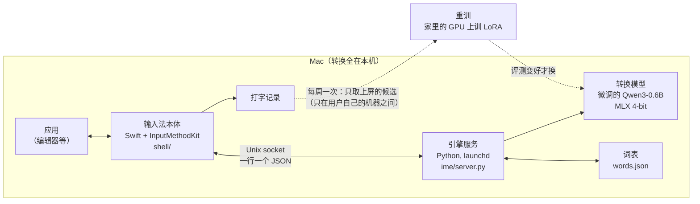

[English](README.md) | [日本語](README.ja.md) | [中文](README.zh.md)

# LLM IME

作者：iren（[iren.page](https://iren.page)：其他作品也在这里）

一个能**简拼整句**的 macOS 中文输入法：每个字只打声母（`wjdzgxfh` → 我觉得这个想法很好），微调过的小语言模型按光标左边的前文猜出整句。模型在 Mac 本机上跑（MLX，4-bit），转换不把打的字发到云端。


在编辑器里只打声母，按空格上屏（[mp4](assets/demo/llm-ime-reel.mp4)）。

## 能做什么

- **简拼、全拼、混着打都行**：`nh` → 你好，`zgwtwmmtztl` → 这个问题我们明天再讨论，不用切换。
- **看前文**：同一串键，前文不同出的句子不同。没有前文时的弱点，用聊天文体的数据微调补上。
- **打错也认得**：相邻两键打反（`zhognguo` → 中国），多打、漏打一个键或按到相邻键（`kanyuix` → 看一下）。
- **记住用户的词**：选过的候选存进本机的词表，下次往前排。每周用用户自己的上屏记录对模型做一次 LoRA 重训，评测变好才换上。
- **不让人等**：每按一个键，先给快猜的结果（M3 MacBook Air 上 p50 约 50 ms），再给整句搜索的结果（4–8 个键 p50 约 80 ms）。

## 架构



- **输入法本体（`shell/`）**：用 InputMethodKit 写的 Swift 程序，管候选窗、翻页、上屏和打字记录。不用 Xcode，只用 Command Line Tools 的 `swiftc` 构建（`shell/build.sh`）。
- **引擎服务（`ime/server.py`）**：每个键一个请求，旧请求丢掉、只回最新的。回答分两步：先回 `quick`（短搜索），再回 `full`（整句 beam search）。
- **转换（`ime/llm.py`）**：模型词表里全是汉字的 token 按每个字的读音放进 trie，beam search 只沿着和键串对得上的 token 走。所有 beam 一起算一个 batch，前文的 KV cache 复用。

## 模型和训练

- **底座**：Qwen3-0.6B-Base。零样本也能做拼音约束的 beam search，但简拼 P@1 只有 11%。
- **训练数据**（`scripts/gen_train.py`）：LCCC（日常对话）和中文 Wikipedia 约 1:1，加约 5% 用户自己在 WeChat 里发出的消息。在句子里随机切一刀，前面当前文，后面 2–16 个字当目标；键串用 `pypinyin` 生成，全拼、简拼、混合各占一份。
- **prompt**：`前文 + 打的键 → 目标`。把键放进 prompt，模型学的是「用这串键打出来的句子」，而不只是「可能的下文」。
- **训练**：在实验室的 GPU（RTX 4090 等）上全量微调（`scripts/train.py`）。前文的 token 也以 0.3 的权重算 LM loss，保住模型本身的语言能力。
- **推理**：微调模型的分数加上底座模型只看前文给的分数（`mix`），比单用哪个都好。
- **每周重训**（`scripts/retrain.py`）：用用户上屏记录做的样本，在家里的 RTX 4070 上训 LoRA（rank 16，2.2 GB），评测比底座好才换上。

## 评测

评测集 892 句（用户自己写的 592 句 + 公开数据 300 句），每句按全拼、简拼、混合三种方式打。指标是 P@1（第一个候选就对的比例，%）。

| 输入 | n-gram + Viterbi（自己写的基线） | Qwen3-0.6B 零样本 | 微调后（v02） |
|---|---|---|---|
| 全拼 | 44.6 | 57.3 | **79.1** |
| 简拼 | 3.1 | 11.1 | **18.4** |
| 混合 | 13.9 | 24.9 | **38.1** |

- 前文最管用：零样本时，有 16 字以上前文，简拼 P@1 从 2.7% 升到 23.1%。n-gram 用不上前文。
- 长句整句简拼信息太少，哪种方法都低。实际打字是分段上屏，所以引擎也给「只读键串前一段」的候选，可以先上屏一部分。
- 打错的评测：混合输入多打一个键时 P@1 0.5% → 20.7%，按到相邻键 0% → 8.6%；打对的输入 P@1 不变（同样 200 句，83.0 / 11.0 / 35.5 → 83.0 / 11.0 / 36.5）。

## 难点

- **简拼 P@1 从 11% 起步。** 零样本模型偏 Wikipedia 文风，不擅长聊天的短句；改 prompt 的说法几乎没用。用「键在 prompt 里」的聊天文体数据微调后，全拼 57 → 79，简拼 11 → 18。
- **想合成一个模型，失败了两次。** 为了提速，试过把两个模型的打分蒸馏进一个模型（r4），和把每个字紧接在它自己的键后面的格式（r4b），都没追上 v02。r4b 的键没有算 loss，切错音节不扣分，训了 8 小时才发现。之后新格式都先训几百步、评 20 句再全量训。
- **底座模型要用它自己的分词打分。** 一个字一个 token 喂进去，会低估平时写在长 token 里的字（还有 的 还）。
- **纠错后的读法，要用纠正后的键重新搜。** 微调模型看着 prompt 里的键打分，纠正后的读法拿原样的键打分必输。纠错读法只给按原样读不通的键，单独放几行，不挤掉简拼。
- **慢在哪，先量再改。** 打字记录看起来加容错后慢了 13–14%，原因其实不是容错，是在等上一个键的整句搜索。用同一进程里逐键交替跑新旧版本的脚本（`scripts/typo_bench.py`）量，p50 只多了不到 1%。
- **在家里的 4070 上训。** 12 GB 的卡平时已经被别的用途占了约 7.5 GB；LoRA + gradient checkpointing + 4k token 的 batch，压到 2.2 GB。

## 隐私

- 转换全在这台 Mac 上完成。打字记录和词表也只在本机；菜单的「删除全部记录」一次删掉记录、词表和个人模型。密码管理器里打的字不记。
- 每周重训的样本只在用户自己的机器之间传，训完就删。
- **模型权重不公开。** 用个人消息训的模型可能原样背出训练句。评测集里也有用户自己的句子，同样不公开。这个仓库只有代码和文档。

## 怎么跑

仓库里没有权重：用公开数据重新训，或者直接用底座模型零样本试。

```sh
python3 -m venv .venv && .venv/bin/pip install mlx mlx-lm numpy pypinyin jieba
# 零样本：把 Qwen3-0.6B-Base 转成 MLX 4-bit 来试
.venv/bin/mlx_lm.convert --hf-path Qwen/Qwen3-0.6B-Base -q --mlx-path models/qwen3-0.6b-base-4bit
make repl ARGS="--engines llm"
# 训练：models/Qwen3-0.6B-Base 放 HF 格式的模型，data/corpus/ 放 LCCC 和 Wikipedia（ime/corpus.py），
# 生成训练数据再训练（不加 --private 就只有公开数据）。训练用 CUDA GPU，另一个 venv（PyTorch + transformers）
python scripts/gen_train.py --out data/train
python scripts/train.py --out runs/r1
# 输入法本体（macOS 13 以上，Apple Silicon）
shell/build.sh
```

## 目录

| 路径 | 内容 |
|---|---|
| `ime/` | 引擎：拼音、n-gram 基线、LLM 转换、打字会话、服务、词表 |
| `shell/` | 输入法本体（Swift / InputMethodKit）、候选窗的 mock、测试 |
| `scripts/` | 训练数据生成、训练、评测、benchmark、部署、每周重训 |
| `CLAUDE.md` | 开发中踩过的坑（英文） |

注释和 commit 信息里的 `5B.8`、`D-019` 等是开发用的计划表里的条目号。

## 用到的数据和许可

本仓库的代码采用 [MIT License](LICENSE)。用到的模型和数据各按自己的许可。

- [Qwen3-0.6B-Base](https://huggingface.co/Qwen/Qwen3-0.6B-Base)（Apache-2.0）
- [LCCC](https://github.com/thu-coai/CDial-GPT)、中文 Wikipedia（训练和字频 `ime/char_freq.tsv`）
- [OpenCC](https://github.com/BYVoid/OpenCC) 的字表（Apache-2.0，`ime/trad_chars.txt`）
- [SCOWL](http://wordlist.aspell.net)（`ime/en_words.txt`，版权声明在文件里）
